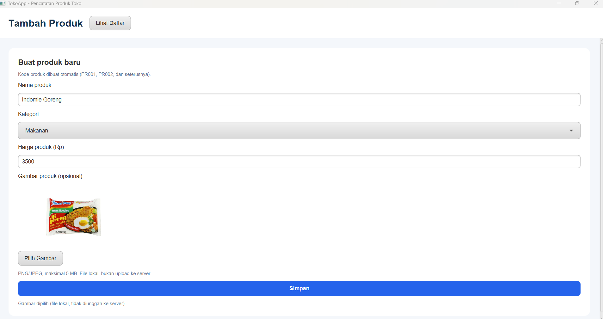
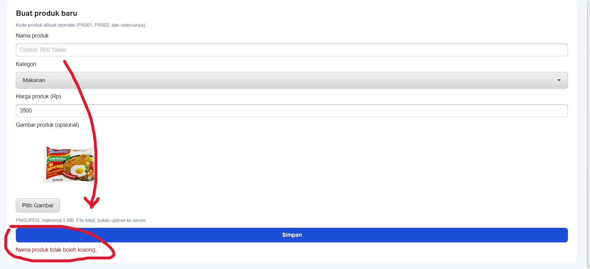
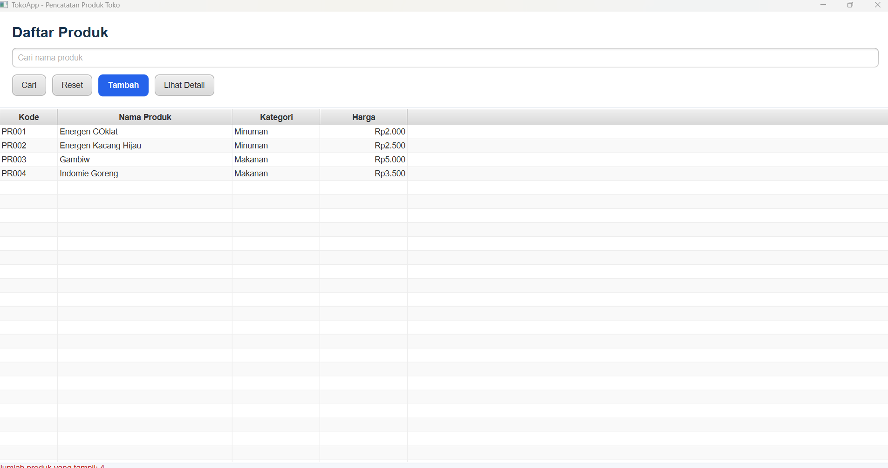
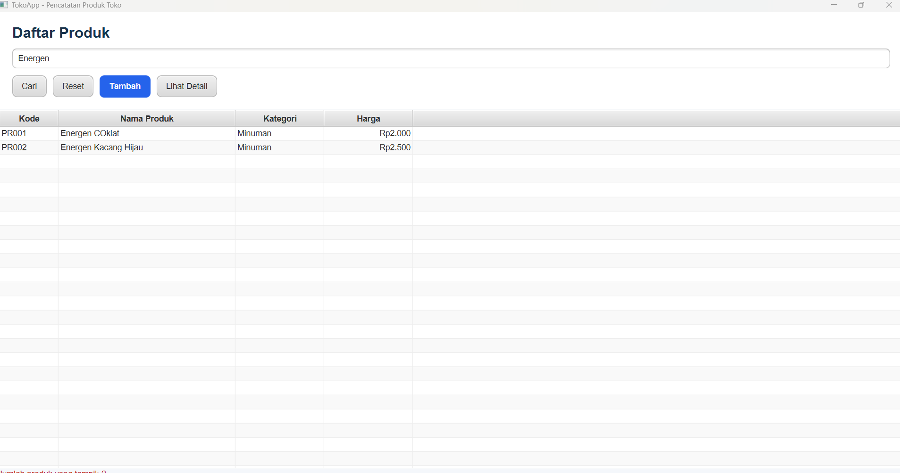
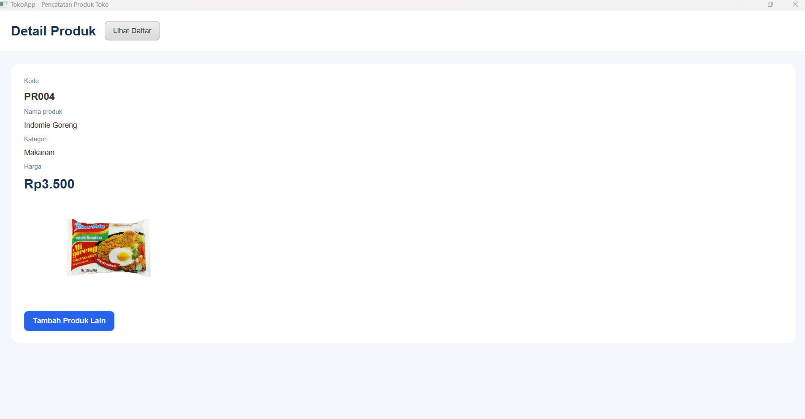

# TokoApp - Aplikasi Pencatatan Produk Toko

Aplikasi desktop berbasis **JavaFX** untuk mencatat produk toko. Pengguna dapat menambahkan produk beserta gambarnya, melihat daftar produk dalam tabel, mencari produk berdasarkan nama, dan membuka halaman detail produk.

## Fitur

- **Tambah produk**: form berisi nama produk, kategori (Makanan/Minuman), harga, dan gambar (opsional).
- **Kode produk otomatis**: PR001, PR002, dan seterusnya.
- **Tabel produk**: menampilkan kode, nama, kategori, dan harga (format rupiah).
- **Pencarian**: berdasarkan nama produk melalui tombol **Cari** (tidak membedakan huruf besar/kecil), dengan tombol **Reset** untuk menampilkan semua produk.
- **Lihat Detail**: membuka halaman detail dari produk yang dipilih di tabel, lengkap dengan gambar produk.
- **Validasi input**: nama tidak boleh kosong, harga harus bilangan bulat lebih dari nol, gambar hanya PNG/JPEG maksimal 5 MB.

> Data hanya disimpan selama aplikasi berjalan (in-memory). Tidak menggunakan database. Gambar tidak diunggah ke server, aplikasi hanya menyimpan lokasi file lokalnya.

## Tampilan Aplikasi

### Form Tambah Produk



### Validasi Input



### Daftar Produk



### Pencarian Produk



### Detail Produk



## Teknologi

- Java (sesuaikan versi dengan `pom.xml`)
- JavaFX (FXML + CSS)
- Maven

## Cara Menjalankan

**Prasyarat:** JDK dan Maven sudah terpasang.

```bash
git clone https://github.com/USERNAME/NAMA-REPO.git
cd NAMA-REPO
mvn clean javafx:run
```

Alternatifnya, buka proyek di NetBeans lalu klik **Run**.

## Penulis

- **Nama:** Wisam Anfaal Mahasin
- **NIM:** 2505151
